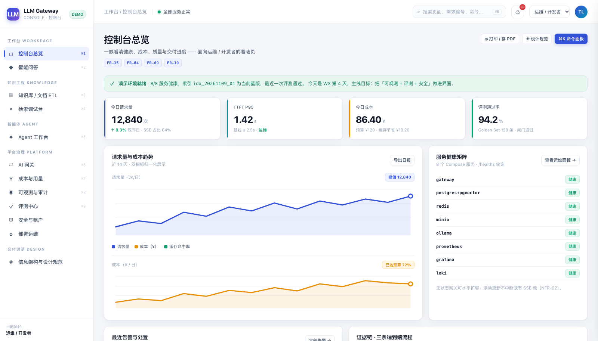
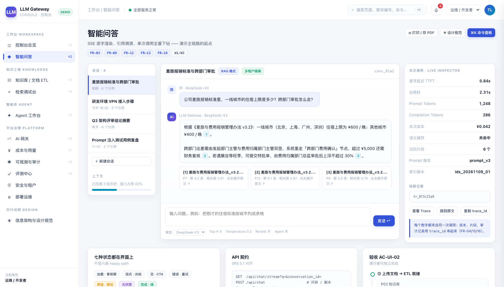

# LLM Gateway Console · Vue 实现

把 `index.html` 那份单文件原型（12 个页面）重建为可维护的 Vue 3 工程。
**界面与原型 1:1 对齐**，但结构从「一个 HTML + 字符串模板」拆成了路由 + 组件 + 状态层，
后续接后端只需要替换数据源。



## 快速开始

```bash
npm install
npm run dev        # http://localhost:5180
```

```bash
npm run build      # 类型检查 + 生产构建
npm run preview    # 预览构建产物
```

## 12 个页面

| 路由 | 页面 | 覆盖需求 |
| --- | --- | --- |
| `/overview` | 控制台总览 | FR-15 / 04 / 09 / 19 |
| `/chat` | 智能问答 | FR-03 / 08 / 12 / 13 / 18 |
| `/docs` | 知识库 / 文档 ETL | FR-06 / 07 / 17 |
| `/retrieval` | 检索调试台 | FR-08 / 09 |
| `/agent` | Agent 工作台 | FR-10 / 11 / 12 |
| `/gateway` | AI 网关 | FR-01 / 02 / 05 |
| `/finops` | 成本与用量 | FR-04 / 17 |
| `/observability` | 可观测与审计 | FR-15 / 16 |
| `/eval` | 评测中心 | FR-09 / 13 |
| `/security` | 安全与租户 | FR-14 / 17 |
| `/ops` | 部署运维 | FR-19 |
| `/design` | 信息架构与设计规范 | FR-18 |

## 目录结构

```
src/
├── data/mock.ts          所有样例数据（接 API 时整体替换）
├── stores/console.ts     Pinia：角色、开关、Tab、ETL/Agent 进度、Toast、抽屉
├── router/index.ts       12 条路由
├── components/
│   ├── AppSidebar.vue    导航（按角色裁剪）
│   ├── AppTopbar.vue     面包屑 / 健康状态 / 角色切换 / 搜索
│   ├── PageHead.vue      页面标题 + FR 徽章 + 全局操作
│   ├── DrawerPanel.vue   右侧抽屉
│   ├── CommandPalette.vue ⌘K 命令面板
│   ├── ToastHost.vue     右下角轻提示
│   └── ui/               16 个基础组件（Card / KPI / Table / Tag / Bar / Tag …）
└── views/                12 个页面
```

## 交互

- 侧栏导航 + 路由（刷新保持当前页）
- 右上角**角色切换**会实时裁剪侧栏（对应原型的 RBAC 预览）
- `⌘K` 命令面板：按页面名 / FR 编号搜索
- 各页面 Tab（可观测 4 个、安全 3 个、运维 4 个）
- 智能问答可真实发消息（本地模拟逐字流式，可停止）
- 知识库「模拟上传」会推进 ETL 五阶段
- Agent「运行」会逐步展开 ReAct 轨迹
- 评测「触发回归」、运维「恢复演练」、上线检查单勾选都会更新状态
- 点击引用卡 / Trace 会打开右侧抽屉

## 后期接接口

目前所有数据来自 `src/data/mock.ts`，状态在 `src/stores/console.ts`。
接后端时按三步改：

1. **建 API 层**：新增 `src/api/client.ts`，封装 `fetch`；
2. **替换数据源**：把 `console.ts` 里 `ref(DOCS)` / `reactive({...})` 换成接口返回，
   页面组件不用动；
3. **代理**：`vite.config.ts` 里已预留 `/api` → `http://127.0.0.1:8081`，
   改成你的网关地址即可。

页面只依赖 store 暴露的字段，所以改造是「替换数据来源」而不是「重写页面」。

## 与原型的关系

原型是单文件、字符串模板渲染；这里做的是等价重构：

| 原型 | 本工程 |
| --- | --- |
| `W.card()` / `W.kpi()` 等字符串助手 | `components/ui/*.vue` 组件 |
| `W.PAGES` 里每页一个 `html()` | `views/*.vue` |
| `W.state` 全局对象 | Pinia `stores/console.ts` |
| `location.hash` 手写路由 | `vue-router` |
| `data-act` 事件委托 | 组件事件 |

CSS 原样搬运（`src/styles/app.css`），所以视觉与原型一致。


